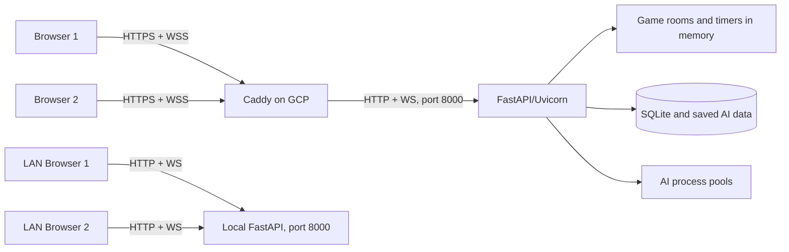

# Connection, Server, GCP, and Demo Handoff

This document explains how Escape Plan connects, how to run it locally or on GCP, what is stored, and what to demonstrate. It contains no passwords or private keys.

## Current Verified Status

- GitHub repository: `https://github.com/nthhhhn/escape-plan`
- Production branch: `main`
- Verified handoff deployment commit: `fd2ce74`
- Public game: `https://34.21.135.108.nip.io`
- Public dashboard: `https://34.21.135.108.nip.io/server`
- Health endpoint: `https://34.21.135.108.nip.io/api/health`
- Verified on 2026-11-02: health returned `status: ok`, native WebSocket transport, and one worker.
- GitHub Actions run `41427581972` tested and deployed handoff commit `fd2ce74` successfully.
- GCP project: `escape-plan-512508`
- VM: `escape-plan-demo`, `asia-southeast1-c`, `e2-small`, 10 GB disk
- Current public IP: `34.21.135.108` (ephemeral)

The public IP is ephemeral. If it changes, the `nip.io` hostname, GitHub `GCP_VM_HOST` secret, and production `.env` domain must be updated before the next deployment.

## Connection Architecture



The React frontend, REST API, and WebSocket endpoint use the same host. The browser therefore connects to whichever address opened the page:

- Local computer: `http://127.0.0.1:8000`
- Two-computer LAN: `http://escape-plan15.local:8000`
- Cloud: `https://34.21.135.108.nip.io`

`frontend/src/config.ts` creates REST requests with relative `/api/...` paths and chooses `ws://` or `wss://` from the page protocol. Players do not enter a server IP in the UI.

## Browser-to-Server Flow

1. FastAPI serves the compiled React application and assets.
2. After a nickname is entered, the browser opens `/ws`.
3. The browser sends `identify` with the nickname and an existing session token, if present.
4. The server creates or restores the player and returns `welcome` with the player ID, token, score, and stage progress.
5. The browser sends a ping every five seconds and reconnects after 1.5 seconds if the connection closes unexpectedly.
6. Room creation, joining, Ready, actions, rematches, and stage changes travel through the WebSocket.
7. The server validates the event, changes the authoritative state, and publishes a role-filtered room view to each player.

Every normal WebSocket request has a unique `request_id`. An action also carries the current `match_id` and `turn_id`. The server rejects duplicate, stale, illegal, expired, or out-of-turn actions.

### Main WebSocket Events

Client events: `identify`, `ping`, `create_room`, `join_room`, `ready`, `action`, `rematch`, `next_stage`, `skip_stage`, and `leave_room`.

Server events: `connected`, `welcome`, `lobby`, `room`, `analysis`, `ack`, `error`, `left`, `reset`, `room_closed`, and `kicked`.

## REST Endpoints

| Endpoint | Purpose | Access |
|---|---|---|
| `GET /api/health` | Service, transport, worker count, and LAN URL | Public |
| `GET /api/training` | Saved Q-learning status and graph data | Public |
| `GET /api/admin` | Clients, rooms, match history, and counts | Admin |
| `POST /api/admin/train` | Start Q-learning training | Admin |
| `POST /api/admin/clients/{id}/disconnect` | Disconnect one client | Admin |
| `POST /api/admin/rooms/{id}/reset` | Reset one room | Admin |
| `POST /api/admin/reset` | Reset all rooms and session scores | Admin |

Cloud admin endpoints require `Authorization: Bearer <ADMIN_TOKEN>`. Local mode may leave `ADMIN_TOKEN` empty, which keeps local dashboard controls unlocked.

## What the Server Owns

FastAPI is authoritative for:

- Room membership, roles, Ready state, and countdown
- Board generation, legal moves, powers, modifiers, capture, and escape
- Turn deadlines, timeout actions, scoring, rematches, and stage progress
- Hidden information such as the Prisoner's concealed position and real tunnel
- AI moves, rollout analysis, coaching, and Q-learning jobs
- Admin reset, training, history, and disconnect operations

The client renders the received view and requests actions. It cannot directly change the board, timer, score, winner, or hidden state.

## Persistence and Restart Behavior

SQLite and saved files persist player scores, match history, map candidates, stage progress, training runs, and Q-learning policies. Docker stores these in the `game-data` volume.

Live rooms, WebSocket connections, locks, countdowns, and timers remain in one Python process. A server restart ends active rooms, although persistent history and trained data remain. Keep Uvicorn at **one worker**. Multiple workers would create separate room states unless the project is redesigned around shared state and coordinated timers.

## Reconnection Behavior

- The browser keeps its player token in `sessionStorage`.
- If a player disconnects during play or countdown, the server pauses the room for up to 20 seconds.
- Reconnecting with the same token restores the player and remaining time.
- If the window expires, the match is aborted without awarding a point.
- Opening the same session in another tab replaces the older socket.
- A server restart cannot restore an active room because rooms are in memory.

## Local and LAN Setup

### First Build

```bash
./scripts/start.sh
```

This installs pinned Python and frontend dependencies, builds React, and starts FastAPI on `0.0.0.0:8000` with one worker.

### Everyday Mac Demo

Double-click `Play Escape Plan.command`. It:

1. Reads the Mac's Bonjour `LocalHostName`.
2. Exports `ESCAPE_LAN_HOST=<name>.local`.
3. Reuses an existing server or starts the installed build.
4. Opens the LAN URL and keeps the server running while its Terminal window stays open.

For the current host, both computers should open:

```text
http://escape-plan15.local:8000
```

Requirements:

- Both computers must be on the same network.
- The host Mac must remain awake.
- Allow incoming local-network connections if macOS asks.
- Guest or campus Wi-Fi may block mDNS or device-to-device traffic.

If `.local` discovery fails but direct LAN traffic is allowed, open the host's LAN IP on port 8000. Because the frontend uses the browser host, no source-code change is needed.

## GCP Deployment

### Production Topology

```text
Internet → GCP public IP → Caddy ports 80/443 → game container port 8000
```

- `nip.io` resolves the IP-based hostname to the VM.
- Caddy redirects HTTP to HTTPS, obtains the TLS certificate, compresses responses, and proxies HTTP and WebSocket traffic.
- The `game` image builds the React frontend, installs the Python backend, and starts one Uvicorn worker.
- Docker Compose restarts both containers unless they are deliberately stopped.
- Persistent Docker volumes keep game data and Caddy certificates/configuration.

### Automated Deployment

Every push to `main` starts `.github/workflows/deploy-gcp.yml`:

1. Check out the exact commit.
2. Install Python 3.12 and Node.js 22 dependencies.
3. Run backend tests.
4. Build the frontend.
5. Verify the VM's pinned ED25519 SSH host-key fingerprint.
6. Connect with the restricted deployment-only SSH key.
7. Ask the VM to deploy the tested 40-character commit SHA.
8. The VM confirms that SHA is the current `origin/main`, rebuilds Compose, and checks the public health endpoint.

The deployment SSH key cannot open an interactive shell; it is forced to run `deploy/gcp-deploy.sh`. Do not force-push `main` while a deployment is running.

### Secrets and Admin Access

Never commit any of these values:

- GitHub environment secret `GCP_DEPLOY_PRIVATE_KEY`
- GitHub environment secret `GCP_VM_HOST`
- GCP `/opt/escape-plan/.env`
- GCP `/var/lib/escape-plan-admin-token`
- Local databases or player session data

The admin token can be read by a teammate who has GCP project permission through Cloud Console SSH:

```bash
sudo cat /var/lib/escape-plan-admin-token
```

Paste it only into the password field on `/server`. The browser keeps it in that tab's `sessionStorage`.

## Connection Security

- Cloud traffic uses HTTPS and secure WebSockets (`WSS`).
- WebSocket origin checks reject a different website unless explicitly listed in `ALLOWED_ORIGINS`.
- Hidden information is removed on the server before each player's state is sent.
- Admin operations use a bearer token and constant-time comparison.
- Request IDs prevent applying retried actions twice.
- Match and turn IDs reject delayed actions.
- Each player is limited to 25 WebSocket requests per second.
- The server allows at most 12 simultaneous rooms.
- Uvicorn limits each WebSocket message to 16 KB.

There are no user accounts. The session token identifies a browser session; it is not an admin credential.

## Demo Preparation Checklist

Complete this before the presentation:

1. Pull the latest `main` and run `./scripts/test.sh`.
2. Confirm the latest GitHub Actions run is green.
3. Open the public health endpoint and confirm `status: ok` and `workers: 1`.
4. Obtain the cloud admin token privately and unlock `/server`.
5. Test the complete room flow from two separate browsers or computers.
6. Test LAN mode on the actual presentation network; keep GCP ready as the fallback.
7. Use different nicknames and separate browser sessions.
8. Prepare one short Classic match and one prepared Stage/Special scenario.
9. Keep `EXTRA_FEATURES.md` open for the selected 10-point feature list.
10. Stop or delete the VM after the final demonstration if it is no longer needed.

## Recommended Live Demo

### 1. Explain the Connection (30 seconds)

Say: “Both browsers connect to one FastAPI server through WebSockets. The server owns the rules, timer, hidden data, and score. The clients only display approved state and request actions.”

Show the architecture diagram or `/api/health`.

### 2. Show the Server Dashboard (30 seconds)

Open `/server` and show connected clients, active rooms, history, and the admin controls. Do not reveal the admin token.

### 3. Demonstrate Two-Client Networking (2–3 minutes)

1. Enter two nicknames on separate computers.
2. Create a Classic room and share the six-character code.
3. Join, Ready both players, and show the synchronized countdown.
4. Make moves from both clients and point out the immediate state update.
5. Let one turn expire to prove the server owns the timer.
6. Refresh one client and reconnect within 20 seconds.
7. Finish by capture or escape; show the score and agreed rematch.
8. Show that the previous winner becomes Warder.

### 4. Demonstrate Extra Features (3–4 minutes)

Use `EXTRA_FEATURES.md`. The recommended package is one AI feature worth 2 points and eight non-AI features worth 1 point each. Show Q-learning in AI Lab, then use prepared Stage and Special matches for the selected non-AI mechanics.

### 5. Show Cloud and Deployment (30–60 seconds)

Open the public GCP URL and the successful GitHub Actions run. Explain that a push to `main` is tested, built, securely deployed, and health-checked automatically.

## Professor Questions and Short Answers

**Why WebSockets?**

Gameplay needs fast two-way updates for moves, timers, rooms, and disconnects. REST remains useful for health, training status, and protected admin commands.

**How do the server and client connect without entering an IP?**

The frontend uses the hostname that served the page. The same build therefore works on localhost, a `.local` LAN hostname, and the HTTPS cloud domain.

**Can a player cheat by editing the browser?**

They can change their display, but the server validates every action and owns the real state, timer, score, and hidden information.

**How is secret information protected?**

The server creates a different observation for each role and omits unauthorized positions and the real-tunnel identity before sending JSON.

**What happens when the internet disconnects?**

The server pauses the match for 20 seconds. The same browser token can reconnect and resume the remaining time; otherwise the match is aborted.

**Why only one Uvicorn worker?**

Live rooms and timers are stored in process memory. Multiple workers would disagree about room state. Scaling would require shared room storage, coordinated timers, and message distribution.

**What survives a restart?**

SQLite records, scores, stage progress, map candidates, and trained policies survive. Active rooms and timers do not.

**How does GCP deployment work?**

GitHub Actions tests the commit, uses a restricted SSH key to request that exact SHA, Docker rebuilds the service, and the deployment finishes only after the HTTPS health check passes.

**What would be needed for many servers?**

Move room state and locks to a shared service, coordinate timers and background jobs, distribute WebSocket events, and route reconnecting players to the correct room owner.

## Troubleshooting

| Problem | Check | Action |
|---|---|---|
| LAN page does not open | Same network, host awake, port 8000, macOS firewall | Try the host's LAN IP; use GCP if the network blocks peer traffic. |
| `.local` name fails | Bonjour/mDNS availability | Use the host's LAN IP without changing the frontend. |
| “Reconnecting” remains visible | `/ws`, page origin, server process | Reload once; confirm `/api/health`; avoid mixing HTTP page with WSS or HTTPS page with WS. |
| Dashboard returns 403 | Cloud admin token | Enter the token from the VM; never put it in source. |
| New code is not visible locally | Frontend build | Run `./scripts/start.sh` after pulling changes. |
| Cloud code is old | GitHub Actions and deployed SHA | Check the latest workflow run and its deploy job. |
| Cloud health fails | VM, Caddy, Compose, DNS | Check VM status, `docker compose ps`, and Caddy/game logs through authorized GCP SSH. |
| Deployment rejects the SHA | Remote branch changed during deployment | Wait for the newer `main` workflow; do not manually deploy the old SHA. |
| SSH fingerprint check fails | VM was rebuilt or host key changed | Verify the new key through GCP before updating the pinned fingerprint. Never bypass the check. |
| Match disappears after restart | In-memory room state | Expected; create a new room. Persistent records should remain. |

## Important Files

- `frontend/src/config.ts` — REST and WebSocket address selection
- `frontend/src/App.tsx` — socket connection, reconnection, messages, and admin requests
- `backend/escapeplan/server.py` — FastAPI, rooms, WebSockets, timers, security, and REST endpoints
- `backend/escapeplan/engine.py` — authoritative game rules
- `backend/escapeplan/storage.py` — SQLite persistence
- `scripts/start.sh` — first build and local server
- `Play Escape Plan.command` — everyday macOS LAN launcher
- `compose.yaml` — cloud services, ports, environment, and volumes
- `deploy/Dockerfile` — production frontend/backend image
- `deploy/Caddyfile` — HTTPS/WSS reverse proxy
- `deploy/gcp-deploy.sh` — restricted exact-commit deployment
- `.github/workflows/deploy-gcp.yml` — test and production deployment workflow
- `EXTRA_FEATURES.md` — presentation feature choices

## Next Work for the Team

1. Rehearse on the exact two computers and network used for grading.
2. Decide the final eight non-AI features from `EXTRA_FEATURES.md` and prepare their game states.
3. Record a backup screen capture in case the presentation network blocks connections.
4. Keep the public IP and `nip.io` domain synchronized if the VM is restarted.
5. Confirm the latest `main` deployment immediately before the demo.
6. After the demo, stop or delete the VM to avoid unnecessary charges.
