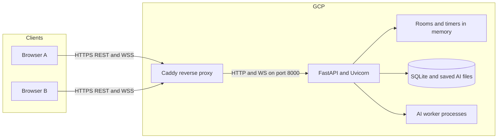

# Escape Plan Connection Handoff

This document explains only the network connection and deployment architecture. It covers how browsers connect to the server, how local/LAN/GCP environments differ, how state is synchronized, what survives a restart, and how to diagnose connection failures.

## Current Connection Status

- Repository: `https://github.com/nthhhhn/escape-plan`
- Production branch: `main`
- Public application: `https://34.21.135.108.nip.io`
- Public dashboard: `https://34.21.135.108.nip.io/server`
- Public health endpoint: `https://34.21.135.108.nip.io/api/health`
- LAN address recorded by the server: `http://escape-plan15.local:8000`
- GCP project: `escape-plan-512508`
- VM: `escape-plan-demo` in `asia-southeast1-c`
- Server process: one FastAPI/Uvicorn worker
- Main gameplay transport: native WebSocket

On 2026-11-02, the public health endpoint returned:

```json
{
  "status": "ok",
  "transport": "native-websocket",
  "workers": 1,
  "lan_url": "http://escape-plan15.local:8000"
}
```

The public IP is ephemeral. If the VM receives a different IP, the `nip.io` hostname and deployment configuration must be updated.

## Architecture



For LAN use, the browsers connect directly to FastAPI on port 8000. Caddy is only needed for the public HTTPS deployment.

## Address Selection

Connection configuration is in `frontend/src/config.ts`:

```ts
export const PROFILE: 'local' | 'lan' | 'cloud' = 'local';
export const HOST = '127.0.0.1';
export const PORT = 8000;
export const API = profile === 'lan' ? `http://${HOST}:${PORT}` : '';
export const WS_URL = profile === 'lan'
  ? `ws://${HOST}:${PORT}/ws`
  : `${location.protocol === 'https:' ? 'wss' : 'ws'}://${location.host}/ws`;
```

The active `local` profile uses **same-origin connections**:

- REST requests use relative paths such as `/api/health`.
- WebSocket requests use the hostname that served the page.
- An HTTP page uses `ws://`.
- An HTTPS page uses `wss://`.

The same compiled frontend therefore works at all three addresses without asking the player for an IP:

| Environment | Page address | API | WebSocket |
|---|---|---|---|
| Same computer | `http://127.0.0.1:8000` | `http://127.0.0.1:8000/api/...` | `ws://127.0.0.1:8000/ws` |
| LAN | `http://escape-plan15.local:8000` | Same host, `/api/...` | `ws://escape-plan15.local:8000/ws` |
| GCP | `https://34.21.135.108.nip.io` | Same host, `/api/...` | `wss://34.21.135.108.nip.io/ws` |

The explicit `lan` profile is only needed if the frontend and backend are served from different hosts.

## Initial Browser Connection

The connection lifecycle is implemented in `frontend/src/App.tsx` and `backend/escapeplan/server.py`.

1. The browser loads the compiled React application from FastAPI.
2. The player enters a nickname.
3. React creates a WebSocket for `/ws`.
4. FastAPI checks the WebSocket `Origin` against the request `Host`.
5. The server accepts the socket and sends the current lobby.
6. The browser sends `identify` within 30 seconds.
7. The server creates or restores the player and responds with `welcome`.
8. React stores the returned session token in `sessionStorage`.
9. The server publishes the updated lobby to all connected clients.

The initial identification message is intentionally sent before normal request-ID processing:

```json
{
  "type": "identify",
  "payload": {
    "nickname": "Player name",
    "token": "existing session token or null"
  }
}
```

The server response includes the player ID, session token, nickname, score, and stage progress:

```json
{
  "type": "welcome",
  "payload": {
    "id": "derived player ID",
    "token": "browser session token",
    "nickname": "Player name",
    "score": 0,
    "progress": 0
  },
  "server_time": 0
}
```

The player ID is derived by hashing the random session token. The raw token is returned only to that browser session.

## Normal WebSocket Messages

After identification, every client event requires a unique `request_id`:

```json
{
  "type": "action",
  "request_id": "unique browser-generated ID",
  "match_id": "current match ID",
  "turn_id": 12,
  "payload": {
    "kind": "move",
    "direction": "right"
  }
}
```

The server responds with an acknowledgement containing the same request ID:

```json
{
  "type": "ack",
  "request_id": "unique browser-generated ID",
  "payload": {
    "ok": true
  },
  "server_time": 0
}
```

`request_id` makes retries idempotent. If the same player sends the same request again, the server returns the cached response instead of applying the action twice.

`match_id` and `turn_id` prevent a delayed action from an old match or old turn from changing the current game.

### Client Events

- `ping` — connection keepalive and clock check
- `create_room` — create a human or bot room
- `join_room` — join a waiting room by code
- `ready` — mark the player ready
- `action` — move, use a power, or apply another game action
- `rematch` — accept a rematch
- `next_stage` — continue after winning a stage
- `skip_stage` — skip a solo stage
- `leave_room` — leave the current room

### Server Events

- `connected` — socket accepted and initial lobby included
- `welcome` — identity and session restored or created
- `lobby` — online clients and joinable rooms
- `room` — role-filtered authoritative room state
- `analysis` — optional rollout result
- `ack` — success or failure for a request
- `error` — malformed request error
- `left` — player left the room
- `reset` — server or room reset
- `room_closed` — room cancelled by an admin action
- `kicked` — this socket was disconnected by the administrator

## State Synchronization

The server is authoritative. The client does not calculate the official result of an action.

For every accepted action, FastAPI:

1. Confirms the room is playing.
2. Confirms `match_id` and `turn_id` are current.
3. Confirms the sender owns the active role.
4. Confirms the server deadline has not expired.
5. Passes the action to the shared rules engine.
6. Stores the action and resulting state.
7. Updates the winner, score, stage, timer, or turn as needed.
8. Builds a separate observation for each role.
9. Sends the updated room state to both clients.

Private information is filtered on the server before JSON is sent. Hiding a UI element is not used as the security boundary.

## Time Synchronization

Every server message includes `server_time`. React calculates an approximate difference between the server clock and browser clock.

Room updates include an absolute deadline calculated from the server's monotonic remaining time. The client uses this for display, but FastAPI decides when a turn expires. Changing the browser clock or pausing client JavaScript does not extend a turn.

The browser sends `ping` every five seconds. This keeps the connection active and gives the server a lightweight connection check.

## Disconnect and Reconnect

- React retries an unexpected closed connection after 1.5 seconds.
- The browser reuses the session token from `sessionStorage`.
- If a player disconnects during countdown or play, FastAPI pauses the room.
- The server records the remaining time and waits up to 20 seconds.
- Reconnecting with the same token restores the player and resumes the stored phase and time.
- If the reconnect window expires, the match is aborted without a score.
- If the same session opens a second socket, the server closes the older socket with code `4001`.
- An administrator disconnect closes the socket with code `4003`, which prevents automatic reconnect.

Reconnection only works while the same FastAPI process is running. A process or VM restart removes live rooms because they are stored in memory.

## REST Connections

WebSocket handles live gameplay. REST is used for health, training information, and administration.

| Method and path | Purpose | Authentication |
|---|---|---|
| `GET /api/health` | Service status, transport, worker count, LAN URL | Public |
| `GET /api/training` | Saved Q-learning training status | Public |
| `GET /api/admin` | Connected clients, rooms, history, and counts | Admin token when configured |
| `POST /api/admin/train` | Start a training process | Admin token when configured |
| `POST /api/admin/clients/{id}/disconnect` | Disconnect one client | Admin token when configured |
| `POST /api/admin/rooms/{id}/reset` | Reset one room | Admin token when configured |
| `POST /api/admin/reset` | Reset rooms and session scores | Admin token when configured |

Cloud admin requests send:

```http
Authorization: Bearer <ADMIN_TOKEN>
```

Local mode may leave `ADMIN_TOKEN` unset. In that case, local admin operations are unlocked. Public deployment must set a private token.

## Local Server Connection

Run:

```bash
./scripts/start.sh
```

The script:

1. Creates `.venv` if needed.
2. Installs backend packages from `backend/requirements.lock`.
3. Installs frontend packages from `frontend/package-lock.json`.
4. Builds React into `frontend/dist`.
5. Starts Uvicorn on `0.0.0.0:8000` with one worker.

FastAPI serves `frontend/dist/index.html`, `/assets`, `/api/...`, and `/ws` from the same process and port.

`0.0.0.0` means the process listens on all network interfaces. Players still connect using a real address such as `127.0.0.1`, the Mac's LAN IP, or its `.local` name.

## macOS LAN Connection

`Play Escape Plan.command` reads the Mac's `LocalHostName` and exports:

```text
ESCAPE_LAN_HOST=<LocalHostName>.local
```

For the current Mac, the expected address is:

```text
http://escape-plan15.local:8000
```

macOS Bonjour/mDNS publishes the `.local` hostname. The FastAPI environment variable does not create DNS; it only makes `/api/health` report the correct sharing address.

LAN requirements:

- The host Mac and client computers must be on the same network.
- The host must remain awake.
- macOS must allow incoming connections to the Python process.
- The network must allow peer-to-peer traffic.
- The network must allow mDNS for `.local` discovery.

Guest Wi-Fi and some campus networks block peer-to-peer connections or mDNS. If mDNS alone is blocked, use the host's LAN IP on port 8000. If peer traffic is blocked, use the GCP deployment.

## GCP Connection

### Request Path

```text
Browser
  → DNS lookup for 34.21.135.108.nip.io
  → GCP public IP on port 443
  → Caddy container
  → FastAPI game container on internal port 8000
```

`nip.io` provides an IP-based DNS name. Caddy uses that hostname to obtain and serve a TLS certificate.

Caddy performs three jobs:

- Redirect port 80 HTTP requests to HTTPS.
- Terminate TLS for HTTPS and secure WebSockets.
- Reverse-proxy all HTTP and WebSocket traffic to `game:8000`.

No separate WebSocket proxy rule is needed because Caddy automatically handles the WebSocket upgrade.

### Docker Compose

`compose.yaml` defines:

- `game` — the combined React/FastAPI application
- `proxy` — Caddy 2
- `game-data` — persistent SQLite, map, and AI files
- `caddy-data` — certificates
- `caddy-config` — Caddy runtime configuration

Only Caddy publishes host ports 80 and 443. The game container exposes port 8000 only to the Docker network.

Both containers use `restart: unless-stopped`.

### Production Image

`deploy/Dockerfile` uses two stages:

1. Node 22 builds the React application.
2. Python 3.12 installs backend packages and copies the compiled frontend.

The final container runs as the non-root `escape` user and starts:

```text
python -m uvicorn escapeplan.server:app \
  --app-dir backend \
  --host 0.0.0.0 \
  --port 8000 \
  --workers 1 \
  --ws-max-size 16384 \
  --proxy-headers
```

`--proxy-headers` allows FastAPI/Uvicorn to respect the original proxy connection information. `--ws-max-size 16384` limits individual WebSocket messages to 16 KB.

## Automated GitHub-to-GCP Connection

Every push to `main` starts `.github/workflows/deploy-gcp.yml`.

### Test Job

1. Check out the pushed commit.
2. Install Python 3.12 and Node.js 22.
3. Install locked dependencies.
4. Run backend tests.
5. Build the frontend.

### Deploy Job

1. Load `GCP_DEPLOY_PRIVATE_KEY` and `GCP_VM_HOST` from the protected GitHub production environment.
2. Scan the VM's ED25519 SSH host key.
3. Compare it with the fingerprint pinned in the workflow.
4. Connect as the restricted `deploy` user.
5. Send `deploy <GITHUB_SHA>`.

The deployment key is forced to run `/usr/local/sbin/escape-plan-deploy`; it cannot open an interactive shell.

`deploy/gcp-deploy.sh` then:

1. Validates the exact command and 40-character SHA.
2. Takes a deployment lock so two deployments cannot run together.
3. Fetches `origin/main`.
4. Rejects the request unless the requested SHA equals current `origin/main`.
5. Resets the VM checkout at `/opt/escape-plan` to that SHA.
6. Runs `docker compose up --build -d`.
7. Reads `DOMAIN` from the VM's `.env`.
8. Retries the public HTTPS health check.
9. Prints container status.

This connects the deployed code to the exact commit that passed the workflow tests.

## State and Persistence Boundaries

### Stored Persistently

- Player score and stage progress
- Match and action history
- Map candidate records
- Training run records
- Q-learning model and graph data
- Docker-managed application data

### Stored Only in One FastAPI Process

- Active WebSocket objects
- Current rooms and membership
- Room locks
- Countdown and turn deadlines
- Live match state
- Pending rematch votes
- Running analysis and AI job references

Do not increase the Uvicorn worker count. Each worker would have different in-memory rooms and timers. Horizontal scaling requires shared room state, distributed locking, coordinated timers, cross-worker WebSocket messaging, and routing for reconnecting players.

## Connection Security

- Public browser traffic uses HTTPS and WSS.
- FastAPI rejects cross-origin WebSocket connections unless the origin is explicitly allowed by `ALLOWED_ORIGINS`.
- Admin REST requests use a bearer token and constant-time comparison.
- Hidden game data is removed from per-role observations on the server.
- Duplicate request IDs return cached results instead of repeating mutations.
- Old match and turn IDs are rejected.
- Each player is limited to 25 WebSocket requests per second.
- The server allows at most 12 rooms.
- The WebSocket message limit is 16 KB.
- Only one active socket is kept for a player session token.
- The deployment verifies the SSH host fingerprint.
- The deployment key can run only the restricted deployment command.

Player session tokens are not administrator credentials. They identify one browser session and restore that player's connection.

## Secrets and Private Data

Do not commit:

- `GCP_DEPLOY_PRIVATE_KEY`
- `GCP_VM_HOST` if the team treats the address as environment-only configuration
- `/opt/escape-plan/.env`
- `/var/lib/escape-plan-admin-token`
- Local SQLite player databases
- Browser session tokens

The cloud admin token is stored on the VM. A teammate with GCP permission can read it through an authorized Cloud Console SSH session:

```bash
sudo cat /var/lib/escape-plan-admin-token
```

Never paste the token into source code, documentation, commits, screenshots, or chat messages.

## Changing the Connection Setup

### If the GCP Public IP Changes

1. Create the new `<IP>.nip.io` hostname.
2. Update `DOMAIN` in `/opt/escape-plan/.env`.
3. Update the GitHub production secret `GCP_VM_HOST`.
4. Confirm GCP firewall access to ports 80, 443, and restricted SSH.
5. Rebuild/restart Compose so Caddy requests the new certificate.
6. Verify `/api/health` through the new HTTPS hostname.

### If the VM Is Rebuilt

The SSH host key will change. Verify the new fingerprint using trusted GCP access, then update the pinned workflow value. Do not disable `StrictHostKeyChecking` or bypass fingerprint verification.

### If Frontend and Backend Use Different Hosts

1. Change the frontend profile to `lan` or provide an equivalent environment-based configuration.
2. Set the correct backend `HOST` and `PORT`.
3. Add the frontend origin to backend `ALLOWED_ORIGINS`.
4. Use HTTPS/WSS together in production to avoid mixed-content blocking.
5. Add proper CORS handling for REST endpoints if cross-origin REST is introduced.

The current same-origin deployment does not need CORS middleware.

### If the Local Hostname Changes

The Mac launcher reads the current `LocalHostName` automatically. Share the new `<name>.local:8000` address. Other computers must use the hostname published by the actual server computer.

## Connection Troubleshooting

| Symptom | Likely cause | Check or action |
|---|---|---|
| Local page will not open | Server stopped or port conflict | Check `http://127.0.0.1:8000/api/health` and the server Terminal output. |
| `.local` page will not open | mDNS blocked or wrong hostname | Check the Mac `LocalHostName`; try the LAN IP. |
| LAN IP also fails | Peer traffic or firewall blocked | Keep the host awake, allow Python connections, or use GCP. |
| UI stays on “Reconnecting” | `/ws` cannot open | Check page protocol, WebSocket URL, origin, server logs, and reverse proxy. |
| WebSocket closes immediately | Origin rejected | Use the same host as the page or configure `ALLOWED_ORIGINS`. |
| Admin API returns 403 | Missing or wrong token | Send the VM's admin token as a bearer token. |
| Actions are rejected as stale | Old `match_id` or `turn_id` | Wait for the latest room update before sending another action. |
| Duplicate action appears ignored | Same `request_id` reused | Generate a new request ID for every new intent. |
| Match pauses | Player socket disconnected | Reconnect with the same browser session within 20 seconds. |
| Match disappears after restart | Live rooms are in memory | Expected; persistent records remain, but create a new room. |
| Public page fails but VM runs | DNS, TLS, Caddy, or firewall issue | Check hostname resolution, ports 80/443, Caddy logs, and Compose status. |
| Deployment rejects SHA | `main` changed during deployment | Allow the newer workflow to deploy; do not deploy the old SHA. |
| SSH fingerprint fails | VM or host key changed | Verify through GCP before updating the pinned fingerprint. |
| New frontend is not visible locally | Old `frontend/dist` build | Run `./scripts/start.sh` after pulling changes. |
| New cloud version is not visible | Workflow/deployment failed | Inspect the latest Actions test and deploy jobs. |

Useful health checks:

```bash
curl http://127.0.0.1:8000/api/health
curl http://escape-plan15.local:8000/api/health
curl https://34.21.135.108.nip.io/api/health
```

Useful VM checks through authorized GCP SSH:

```bash
cd /opt/escape-plan
docker compose ps
docker compose logs --tail=100 game
docker compose logs --tail=100 proxy
```

## Important Connection Files

- `frontend/src/config.ts` — API and WebSocket URL selection
- `frontend/src/App.tsx` — socket lifecycle, pings, reconnect, messages, and REST calls
- `backend/escapeplan/server.py` — WebSocket handler, rooms, timers, REST routes, and security
- `backend/escapeplan/storage.py` — SQLite persistence
- `scripts/start.sh` — local build and server startup
- `Play Escape Plan.command` — macOS LAN launcher and Bonjour hostname selection
- `compose.yaml` — application/proxy containers, ports, environment, and volumes
- `deploy/Dockerfile` — production image and Uvicorn command
- `deploy/Caddyfile` — HTTPS/WSS reverse proxy
- `deploy/gcp-deploy.sh` — restricted exact-commit deployment
- `.github/workflows/deploy-gcp.yml` — test and GCP deployment workflow
- `.env.example` — required cloud `DOMAIN` and `ADMIN_TOKEN` names

## Continuation Notes

- Keep one Uvicorn worker until live state moves to shared infrastructure.
- Keep frontend and backend same-origin unless there is a clear reason to split them.
- Recheck LAN access on any new network because mDNS and peer traffic policies differ.
- Recheck the GCP IP after stopping or restarting a VM with an ephemeral address.
- Verify the SSH fingerprint after rebuilding the VM.
- Verify the latest GitHub Actions run and public health endpoint after every production change.
- Stop or delete the GCP VM when it is no longer needed to avoid charges.
